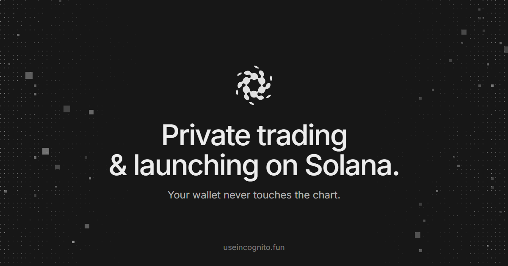
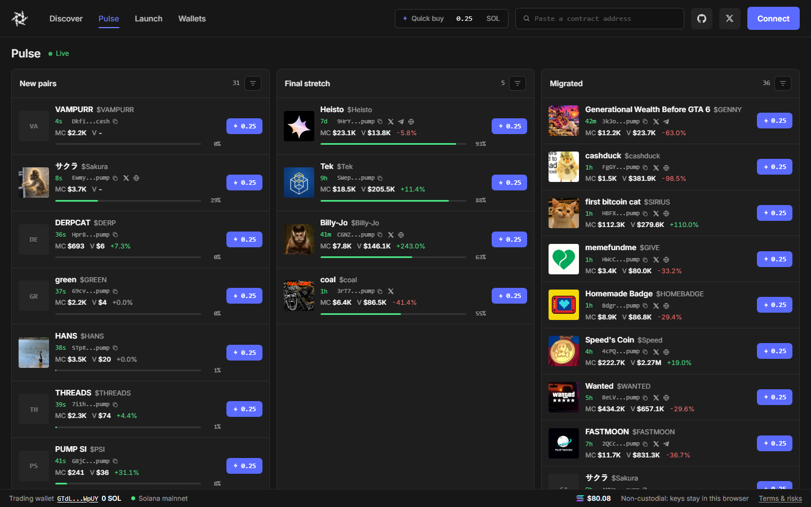
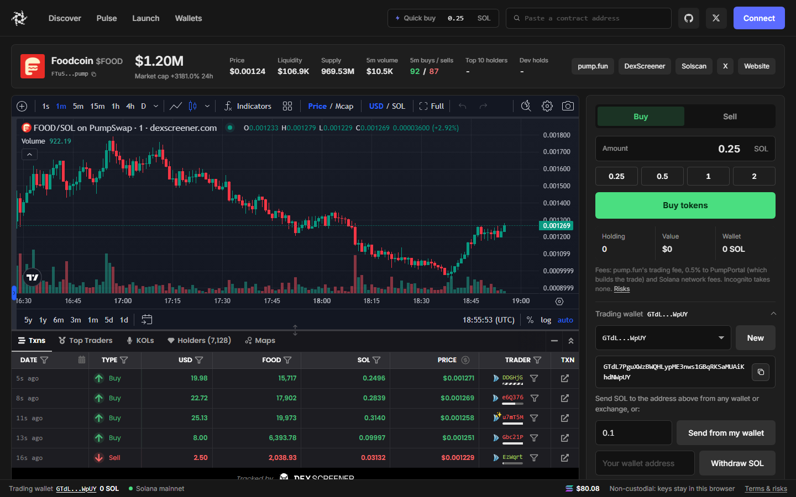
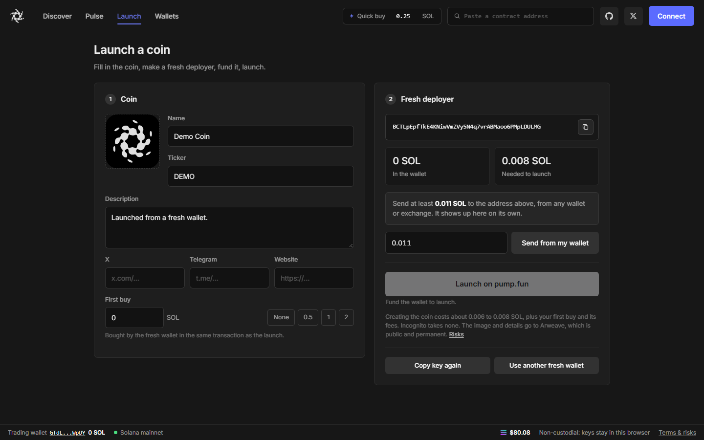
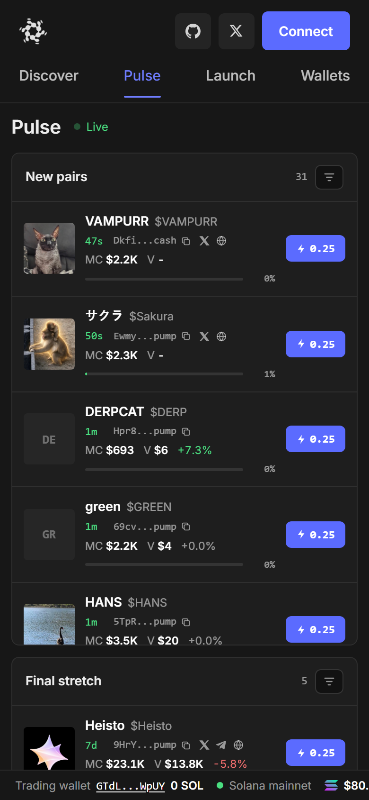
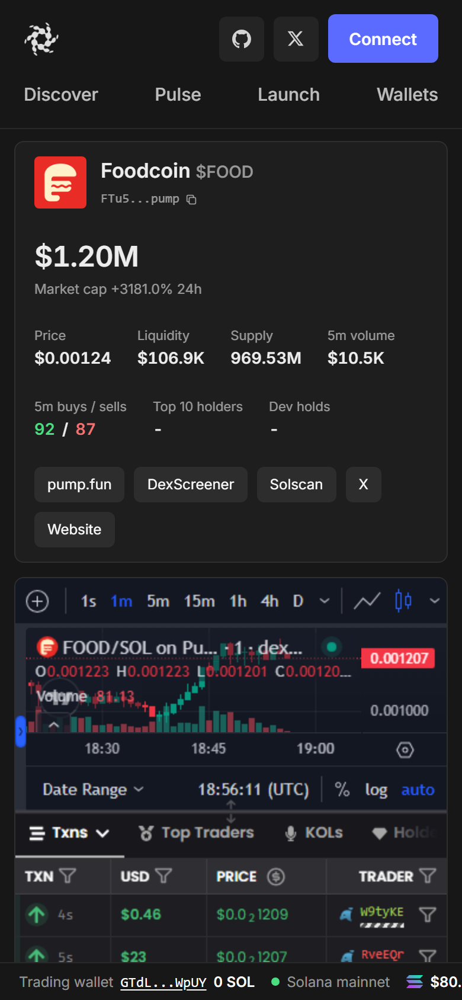

<p align="center">
  
</p>

<p align="center">
  <a href="https://github.com/IncognitoPTCL/incognito/actions/workflows/ci.yml"></a>
  <a href="https://github.com/IncognitoPTCL/incognito/actions/workflows/verify.yml"></a>
  <a href="LICENSE"></a>
  <a href="https://www.useincognito.fun"></a>
</p>

# Incognito

Private trading and launching on Solana. Buy and sell any pump.fun coin, or launch your own, from fresh wallets made in your browser, so your main wallet never touches the chart. Non-custodial and open source.

**Live:** [useincognito.fun](https://www.useincognito.fun) · **X:** [@IncognitoPTCL](https://x.com/IncognitoPTCL)



## The idea

Your wallet is public: every buy, every sell, every size, forever. Trackers label it, copy bots follow it in seconds, and the moment you launch a coin, everyone can see who the creator is and what else that wallet holds.

Incognito takes your main wallet out of the picture. **Every launch and every trade runs from a brand-new wallet made in your browser.** That wallet has no history, no label and no other holdings. On the chart you see a fresh wallet trading, never your main one.

There is no account and no deposit into anyone else's wallet. The keys are made and kept in your browser; the server never sees them and never signs anything. You back each key up (it imports straight into Phantom) and you can withdraw everything at any time.

## What the chain sees

| Step | Public | Kept off the chart |
| --- | --- | --- |
| Make a fresh wallet | nothing (the key is made in your browser) | - |
| Fund it | the transfer: which wallet sent it, which received it, how much | - |
| Buy or sell a coin | the fresh wallet's trades, sizes and holdings | your main wallet: it never appears in the coin's trades or holders |
| Launch a coin | the fresh wallet as the creator, the coin, its first buy | your main wallet as the creator, and everything else it holds |
| Claim creator fees | the claim, paid to the fresh wallet | your main wallet |
| Withdraw | the transfer back: where it went and how much | - |

**Honestly:** a fresh wallet hides your main wallet from the chart, not from the blockchain. Anyone who follows the funding transfer can link the two. What disappears is your main wallet from the coin's chart, trades and holder list.

## What you can do

| | |
| --- | --- |
|  |  |
| **Coin page**: chart, live trades, market cap, liquidity, holders, top 10 and dev share, and a buy and sell panel with presets. | **Launch**: a pump.fun coin from a fresh deployer, with an optional first buy in the same transaction. |

- **Discover**: trending pump.fun coins with market cap, liquidity, volume and transactions for 5m, 1h, 6h or 24h, sortable, with one-click buys.
- **Pulse**: New pairs, Final stretch (bonding-curve progress read from the chain) and Migrated, live over a websocket.
- **Filters** on every list: market cap, liquidity, volume, age, transactions, bonding %, socials, DEX paid, keywords.
- **X previews**: hover a coin's X link to see the profile or the tweet.
- **Quick buy**: one click from any list. With no wallet yet, a panel walks you through making one, saving its key and funding it.
- **Wallets**: every fresh wallet made in this browser. Back up a key, import one, withdraw all SOL, or claim creator fees.
- **Phones**: the whole terminal works at phone width.

<p align="center">
  
  &nbsp;
  
</p>

SOL pairs only: coins priced in another token (pump.fun now allows some) are left out, because SOL trades cannot fill them.

## How it works

```
browser                                         server (holds no key)
-------                                         ---------------------
fresh keypair (WebCrypto Ed25519)
   |  public address only
   +-------------------------------------------> /api/create, /api/trade, /api/claim
                                                    ask PumpPortal for an UNSIGNED transaction
                                                    dry-run it on mainnet (trades)
   <--------------------------------------------- unsigned transaction
check who signs it and which program it calls,
then sign locally
   +-------------------------------------------> /api/rpc  (sendTransaction, relayed as-is)
```

**Launching** adds one step before the transaction: the coin's image and metadata go to Arweave straight from the browser, as ANS-104 data items signed by a throwaway key, through [ArDrive Turbo](https://ardrive.io/turbo)'s free tier (files under 105 KiB; the image is shrunk to fit). The link is live the moment the upload returns, so pump.fun can read it right after the launch. If the upload fails, nothing has been signed.

**Code map**

| File | What it does |
| --- | --- |
| `public/sol.js` | Keypairs, signing, base58 and a hand-built SOL transfer, with no library. |
| `public/host.js` | Arweave hosting for launches: image shrinking, ANS-104 data items, upload. |
| `public/app.js` | Launch, trade, wallets, quick buy and routing. |
| `public/terminal.js`, `public/discover.js` | Pulse and Discover. |
| `lib/app.mjs` | Every API route as one handler, with per-visitor rate limits. `server.mjs` runs it locally; `build.mjs` bundles it into `api/index.mjs` for Vercel. |

## Verify it yourself

Nothing here asks you to take it on trust. Two commands check the parts that matter:

```bash
npm test          # offline: byte-for-byte parity with the reference libraries
npm run verify    # online: every transaction type, simulated on Solana mainnet
```

**`npm test`** checks that the hand-written signing code produces exactly what `@solana/web3.js` produces (addresses, transfer messages, signatures), and that the Arweave data items are byte-identical to `@dha-team/arbundles` (the library ArDrive Turbo uses) and verify with it. It runs on every push ([CI](https://github.com/IncognitoPTCL/incognito/actions/workflows/ci.yml)).

**`npm run verify`** builds each transaction through the live site's API exactly as it does for a visitor, then simulates it against current mainnet state. Nothing is signed or sent and no key is needed. It also runs every six hours on GitHub ([Mainnet dry run](https://github.com/IncognitoPTCL/incognito/actions/workflows/verify.yml)). A run from 13 November 2026:

```
Incognito transaction check against https://www.useincognito.fun

Live lists: 27 new, 13 final stretch, 14 migrated

PASS  Buy 0.01 SOL of $Tek on the bonding curve  (121268 compute units, 1 signer)
PASS  Sell 50% of $Tek back to the curve  (118810 compute units, 1 signer)
PASS  Buy 0.01 SOL of $CATE on PumpSwap (graduated)  (121533 compute units, 1 signer)
PASS  Launch a coin (no first buy)  (100058 compute units, 2 signers)
PASS  Launch a coin with a 0.01 SOL first buy in the same transaction  (249680 compute units, 2 signers)
PASS  Claim creator fees as the creator of $BetOnBlak  (32154 compute units, 1 signer)
PASS  Withdraw 0.005 SOL (transfer built by public/sol.js)  (150 compute units, 1 signer)

7 of 7 passed. Simulated only: nothing was signed or sent.
```

Point it at your own copy with `npm run verify -- http://localhost:4981`.

## Data sources (all keyless)

| What | From |
| --- | --- |
| Launch, trade and claim transactions | [PumpPortal](https://pumpportal.fun) `trade-local` |
| New coins and graduations, live | PumpPortal websocket |
| Column lists, trending | [GeckoTerminal](https://www.geckoterminal.com) |
| Market data, chart | [DexScreener](https://dexscreener.com) |
| Bonding-curve progress, holders, top 10 and dev share | the chain itself, over Solana RPC |
| Coin images and metadata for launches | Arweave through [ArDrive Turbo](https://ardrive.io/turbo), served from ardrive.net |
| X previews | [FxTwitter](https://github.com/FixTweet/FxTwitter) |

## Fees

Incognito charges nothing. pump.fun's own trading fee applies, PumpPortal takes 0.5% of each trade it builds, and Solana network fees apply to every transaction.

## Run it

Needs Node 20+.

```bash
npm install
cp .env.example .env.local   # optional
npm start                    # http://localhost:4981
```

| Variable | Why |
| --- | --- |
| `SOLANA_RPC` | Your own RPC URL (Helius, Triton...), or a bare Helius API key. Without it the server falls back to two public endpoints, which rate-limit under load. It is never echoed in a response. |
| `PINATA_JWT` | Optional: host launch images on IPFS through Pinata instead of Arweave. |
| `PAD_PASSWORD` | Optional: ask for a password before anything works. |
| `LAUNCH_PRIORITY_FEE_SOL`, `LAUNCH_MAX_BUY_SOL` | Priority fee and first-buy cap. |

Deploy with `bash deploy.sh` (Vercel). The API is prebuilt, so Vercel installs nothing.

## Safety

- Back up a fresh wallet's key before you fund it. It lives only in your browser; clearing site data without a backup loses whatever is in it.
- Every transaction PumpPortal builds is checked (who signs it, which program it calls) before your browser signs it, and trades are dry-run on mainnet first.
- Memecoins can go to zero. Nothing here is advice. See the site's [terms, privacy and risks](https://www.useincognito.fun/legal.html), and [SECURITY.md](SECURITY.md) for the security model and how to report an issue.

## License

MIT. See [LICENSE](LICENSE).
